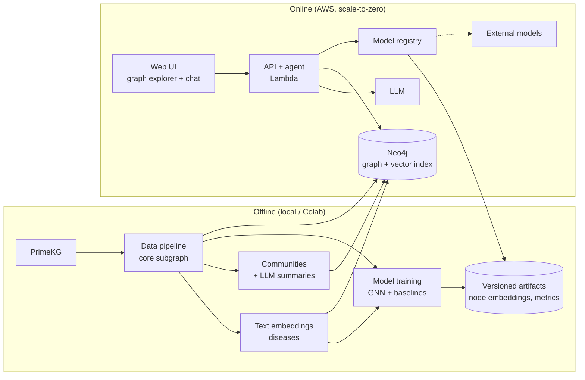

# Ariadne Biograph — Design Document

> **This is the source of truth** for vision, principles, architecture, stack and conventions.
> It is a *living* document: when something here changes, update it in the same PR as the code.
> Component-level detail lives in [`specs/`](specs/). The history of *why* lives in [`decisions.md`](decisions.md).

**Status:** Phase 0 (setup) · **Last updated:** 2026-11-09

---

## 1. Purpose

Ariadne Biograph lets a biologist explore a biomedical knowledge graph and ask questions
in natural language, including requests for predictions:

> *"Which genes might be involved in disease X, and is there an existing drug that acts on them?"*

The system answers by combining:

1. **Retrieval** over the graph: semantic search on disease names and descriptions, and community-level search.
2. **Graph queries** (Cypher).
3. **Predictive models** for gene–disease associations (GDA). Models are pluggable: there can be several, and a user can register their own.
4. **Explanations**: every prediction comes with paths or subgraphs that the user can follow and verify. These are the *thread* in the name.

### Users
- **Primary:** a biologist or biomedical researcher. They are not expected to write code or Cypher. They want hypotheses they can check, not black-box scores.
- **Secondary:** an ML researcher who wants to plug in their own model and compare it.

### Non-goals
- Clinical decision support. All outputs are **research hypotheses**, and the UI says so.
- Building or curating a knowledge graph from raw sources. We use PrimeKG as is.
- Being a benchmark paper. We want *reasonable rigor*, not exhaustive model search.

### Origin
This project continues the author's undergraduate thesis on GNNs for gene–disease prioritization
([code](https://github.com/ingridheuer/gcnn_gdas)). Ideas carried over from it are marked with *(thesis)*.

---

## 2. Principles

These guide every decision. When two options look equivalent, pick the one that respects more of these.

1. **Explainable over clever.** A prediction the user cannot trace is worth little in science.
2. **Honest evaluation.** Negative sampling and splits are designed so the model cannot win by favoring hubs *(thesis)*. Always compare against simple baselines.
3. **One graph everywhere.** The model, the graph database and the UI use *the same* subgraph, so an explanation never refers to an edge the model did not see.
4. **Standard identifiers at boundaries.** Components talk in biological IDs (gene, disease, drug), never in tensor indices.
5. **Scale to zero.** With no traffic, infrastructure costs ≈ $0. Every cloud resource is created and destroyed by code.
6. **Reproducible by default.** One command rebuilds data, one trains, one deploys. Configuration lives in files, not in notebooks.
7. **Small, reviewable steps.** Each phase ships something that works and can be shown.

---

## 3. System overview



| Component | Responsibility | Spec |
|---|---|---|
| Data pipeline | Download PrimeKG, build the core subgraph, export tables and `HeteroData` | `specs/data-pipeline.md` |
| EDA | Network analysis, communities, static interactive map | `specs/eda.md` |
| Embeddings | Text embeddings for disease nodes (GNN features + semantic search) | `specs/embeddings.md` |
| Model contract | Common interface every predictor implements | `specs/model-contract.md` |
| GNN (GDA) | Heterogeneous GNN for gene–disease link prediction | `specs/gnn-gda.md` |
| Evaluation | Splits, negative sampling, metrics, stratified reports | `specs/evaluation.md` |
| Graph store | Neo4j schema, loading, `GraphRepository` interface | `specs/graph-store.md` |
| Retrieval | Semantic + community-level retrieval | `specs/retrieval.md` |
| Agent | LLM with tools: retrieval, Cypher, predict, explain | `specs/agent.md` |
| API + UI | Backend endpoints, graph explorer, chat | `specs/ui.md` |
| Infrastructure | IaC, scale-to-zero, cost controls | `specs/infra.md` |

Specs are written **when a component's phase starts**, not upfront.

---

## 4. Data

**Source:** [PrimeKG](https://github.com/mims-harvard/PrimeKG) (Chandak, Huang & Zitnik, *Scientific Data* 2023), used as is.
Disease nodes inherit PrimeKG's grouping of similar diseases. This is a known trade-off: the thesis avoided it on purpose, but it keeps the pipeline simple and reproducible.

### Core subgraph

We keep the node and edge types relevant to gene–disease prediction and drug repurposing.
We drop the two edge types that make up ~70% of PrimeKG and do not serve that goal.

| Included node types | gene/protein, disease, pathway, phenotype (effect), drug |
|---|---|
| **Included edge types** | protein–protein, disease–protein (**GDA, supervision target**), disease–disease, pathway–protein, pathway–pathway, disease–phenotype, phenotype–phenotype, phenotype–protein, drug–protein (targets), drug–disease (indication / contraindication / off-label), drug–phenotype (side effects) |
| **Excluded** | anatomy–protein (37.5% of edges), drug–drug interactions (33%), biological process / molecular function / cellular component, exposure |

Size estimate: ~1.6M directed edges. To be confirmed by the EDA.
The subgraph is **defined in configuration**, so adding a type later is a config change followed by a rebuild.

---

## 5. Modeling

- **Task:** link prediction on GDA edges, in a transductive setting.
- **Baseline first:** a degree / popularity predictor is the first implementation of the model contract. Every other model must beat it.
- **Negative sampling:** degree-aware, with P(v) ∝ deg_GDA(v)^0.75, from the start *(thesis)*. Negatives are regenerated during training.
- **Splits:** random edge split plus a set of **held-out diseases** (cold-start). Results are stratified into *known disease*, *new disease* (no GDA in train but connected to the graph) and *no information* *(thesis)*.
- **Metrics:** AUROC and AUPRC for pairwise ranking, plus Hits@K and MRR for per-disease ranking. The context-based protocols from the thesis (genomic neighborhoods, PPI neighborhoods) are reused where feasible.
- **Hyperparameter search:** evolutionary and bounded, a reformulation of the thesis's Metropolis–Hastings walks. Budget-capped, not exhaustive.
- **Serving:** the GNN is transductive, so node embeddings are precomputed offline. A prediction is a dot product, which means no PyTorch in production.
- **Drug repurposing:** derived by reasoning over the graph, not by a separate model. The chain is *disease → predicted gene → drugs targeting it*, filtered by contraindications. A dedicated drug–indication model is an optional, late addition.

---

## 6. Stack

| Area | Choice | Status |
|---|---|---|
| Language | Python 3.12 | ✅ decided |
| Env & packaging | [uv](https://docs.astral.sh/uv/), `src/` layout | ✅ |
| Lint / format | ruff | ✅ |
| Tests | pytest | ✅ |
| CI | GitHub Actions | ✅ |
| Graph ML | PyTorch + PyTorch Geometric | ✅ |
| Data | pandas / polars + parquet | ⏳ Phase 1 |
| Network analysis | networkx / igraph, Leiden | ⏳ Phase 1 |
| Text embeddings | sentence-transformers (local) vs API | ⏳ Phase 1 |
| HPO | Optuna (evolutionary / multi-objective samplers) vs custom | ⏳ Phase 2 |
| Experiment artifacts | S3 or Hugging Face Hub | ⏳ Phase 2 |
| Graph DB | Neo4j (Docker locally, EC2 on demand in production) | ✅ |
| LLM | Bedrock vs direct API | ⏳ Phase 3 |
| UI | Static frontend + graph library (Cytoscape.js / sigma.js) | ⏳ Phase 4 |
| Cloud | AWS: Lambda, S3, CloudFront, EC2 | ✅ |
| IaC | Terraform vs CDK vs SAM | ⏳ Phase 4 |

---

## 7. Repository layout (target)

```
ariadne-biograph/
├── docs/design/            # this document, decisions, specs
├── src/ariadne_biograph/
│   ├── data/               # download, subgraph build, exports
│   ├── features/           # text embeddings, node features
│   ├── models/             # model contract, baselines, GNN
│   ├── evaluation/         # splits, negative sampling, metrics
│   ├── graph/              # GraphRepository, Neo4j loading
│   ├── retrieval/          # semantic + community retrieval
│   ├── agent/              # LLM tools and orchestration
│   └── api/                # backend endpoints
├── configs/                # YAML configs (subgraph, training, ...)
├── notebooks/              # exploration and reports only; no logic lives here
├── infra/                  # IaC
├── ui/                     # frontend
└── tests/
```

Folders are created when they get their first real content.

---

## 8. Conventions

**Code**
- Type hints everywhere public, and ruff-clean.
- Small modules with pure functions where possible. I/O lives at the edges.
- Paths, seeds and hyperparameters come from config files, never hardcoded.
- Notebooks *call* package code. If a notebook cell is worth keeping, it moves into `src/`.

**Data**
- Raw downloads go to `data/raw/` and derived data to `data/processed/`. Both are git-ignored and rebuilt by command.
- Downloads are verified by checksum. Every output records the config that produced it.

**Git**
- `main` is protected. All work goes through branches and PRs. Branch names: `phase-N/<topic>` or `feat/<topic>`.
- One PR is one reviewable unit of change. PRs that touch design must update this document.
- Commit messages are imperative and in English.

**Docs & language**
- Repository content (code, docs, README) is in English.
- Specs follow [`specs/TEMPLATE.md`](specs/TEMPLATE.md).

---

## 9. Operations & cost

- Every AWS resource is defined in IaC, so `deploy` and `destroy` are each a single command.
- An AWS Budget alert is set before the first deploy.
- Every phase that adds infrastructure documents its estimated monthly cost and how to shut it down.
- Current account: AWS Free account plan (credits-based). Target idle cost: ≈ $0.

---

## 10. Roadmap

| Phase | Deliverable |
|---|---|
| 0. Setup | Repo, tooling, CI, design docs |
| 1. Data + EDA | Reproducible core subgraph; network EDA with figures; communities; static interactive map; disease text embeddings |
| 2. Models | Model contract; baselines; GNN for GDA with honest evaluation; bounded evolutionary HPO; Colab training; versioned artifacts; model card |
| 3. GraphRAG (local) | Neo4j + vector index; community summaries; agent with all tools, including disease → gene → drug |
| 4. UI + AWS | Graph explorer + chat; scale-to-zero deployment with IaC and cost controls |
| 5. External models | Users register their own predictors as tools; optional drug–indication model |

---

## 11. Glossary

- **GDA:** gene–disease association.
- **Core subgraph:** the subset of PrimeKG defined in §4.
- **Model contract:** the interface every predictor implements; see `specs/model-contract.md`.
- **Known / new / no-information disease:** evaluation strata, based on what the training graph knows about each disease *(thesis)*.
- **Scale-to-zero:** the infrastructure costs nothing while unused.
